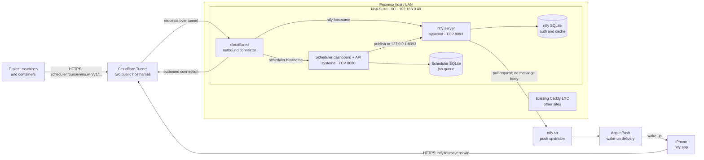

# Network diagram

**Public URLs:** `https://ntfy.foursevens.win` serves ntfy topics and the ntfy web app. `https://scheduler.foursevens.win` serves the scheduler dashboard and `/v1/...` API. The existing Caddy sites and `champyy.ddns.net` VPN stay separate.

**Immediate event:** A machine posts an event name to the scheduler; the scheduler reads its preset from `events.json`, writes a job to SQLite, and publishes to the project's ntfy topic. Scheduled and recurring jobs use the same delivery path when due.

**iOS delivery:** ntfy sends a wake-up request through `ntfy.sh` and Apple Push Notification service. The iPhone then fetches the notification content through `ntfy.foursevens.win` and the tunnel. The ntfy upstream receives a poll request, not the notification body. The iPhone must be able to reach the public HTTPS URL outside the LAN.

**LAN access:** `cloudflared` runs on Noti-Suite and connects outward to Cloudflare. The two published application routes point to Noti-Suite's loopback ports 8093 and 8080. No inbound router forwarding is needed.
